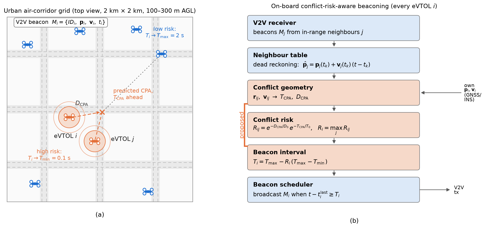
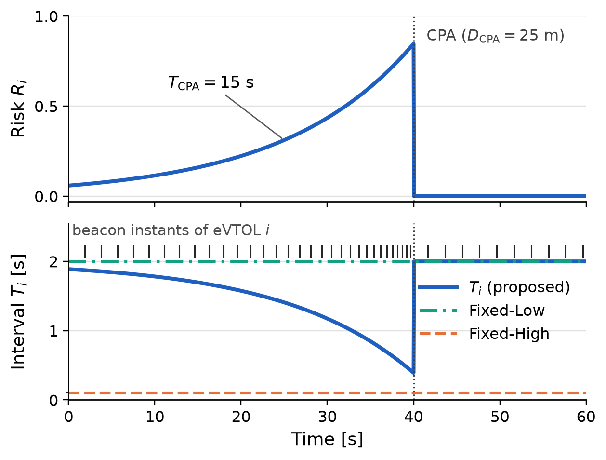
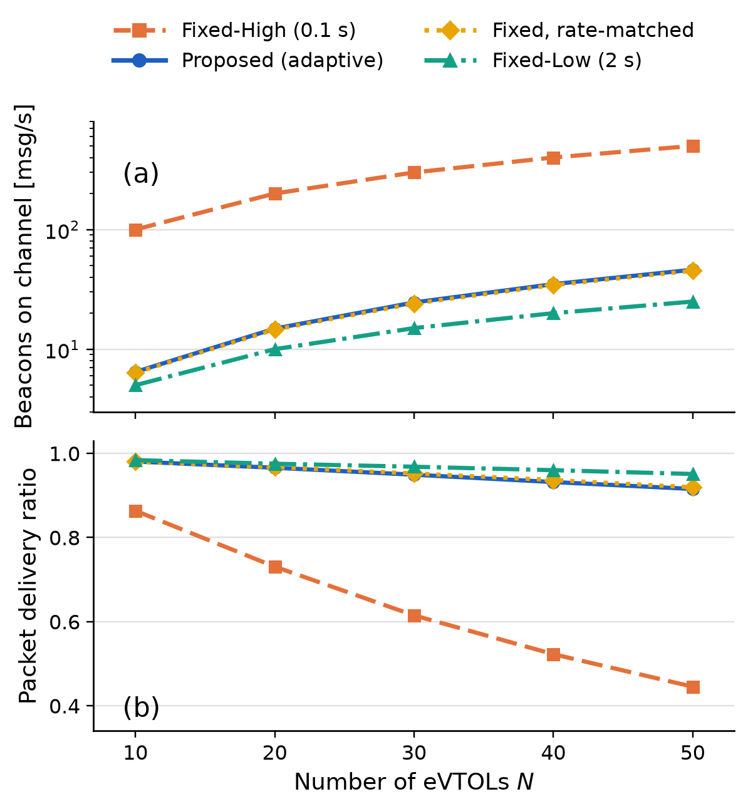
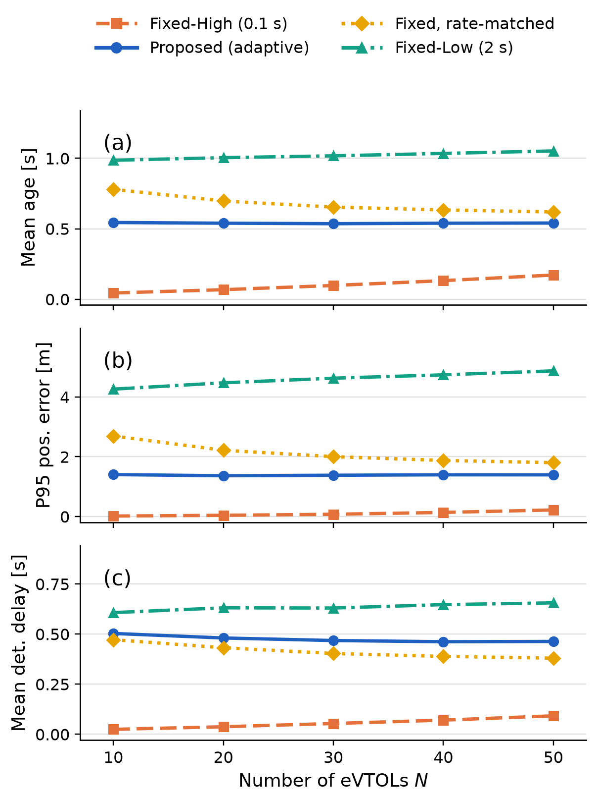

# Conflict-Risk-Aware Adaptive V2V Beaconing for eVTOL Air Taxis — simulation code

Simulation code for the paper *“Conflict-Risk-Aware Adaptive V2V Beaconing for
eVTOL Air Taxis in Urban Air Corridors”*.

**Repository:** <https://github.com/rizkyebayer-idr/evtol-conflict-aware-beaconing>
&nbsp; [](https://github.com/rizkyebayer-idr/evtol-conflict-aware-beaconing/actions/workflows/reproducibility.yml)

The repository contains one script per figure, one per table, and a shared
NumPy implementation of the model:

* `v2vbeacon/` — corridor mobility, conflict geometry, the adaptive beaconing
  rule, the unslotted random-access channel and all metrics;
* `fig*.py` — one program per figure (Figs. 1–4);
* `table*.py` — one program per table (Tables II–III);

[`PAPER_MAP.md`](PAPER_MAP.md) maps every claim of the paper to the function
that implements it; `fig2_crossing_encounter.py` is the shortest complete
example of the mechanism (~130 lines, analytic).

---

## Requirements

Python ≥ 3.9 with **NumPy** and **Matplotlib** only (as stated in Sec. IV of the
paper).  No SciPy, no pandas, no external data.

```bash
pip install -r requirements.txt
```

## Quick start

```bash
python run_all.py               # sweep + all figures + tables
python run_all.py --skip-sweep  # reuse results/sweep.csv (~20 s)
```

Individual scripts:

```bash
python run_sweep.py                # traffic-density sweep, N = 10..50, 50 runs
python run_sweep_parallel.py 50    # same, one process per density
python fig1_system_overview.py     # Figure 1
python fig2_crossing_encounter.py  # Figure 2
python fig3_channel_load.py        # Figure 3   (needs results/sweep.csv, or --force)
python fig4_timeliness.py          # Figure 4
python table2_main_results.py      # Table II
python table3_risk_scales.py       # Table III  (--force to recompute)
```

Wall-clock time on a 14-core laptop: full sweep ≈ 27 min with
`run_sweep_parallel.py` (≈ 1.5 h serially), Table III ≈ 8 min in parallel
(≈ 15 min serially), each figure < 5 s.  A configuration is vectorised over its
Monte Carlo runs, so one `simulate()` call handles all 50 repetitions at once.

## What is in here, in one table

| Script | Reads | Writes |
|---|---|---|
| `fig1_system_overview.py` | nothing (drawing) | Figure 1 |
| `fig2_crossing_encounter.py` | nothing (analytic) | Figure 2 |
| `fig3_channel_load.py` | `results/sweep.csv` | Figure 3 |
| `fig4_timeliness.py` | `results/sweep.csv` | Figure 4 |
| `table2_main_results.py` | `results/sweep.csv` | Table II |
| `table3_risk_scales.py` | simulation (cached json) | Table III |

**Paper → code in one sentence:** the traffic model of Sec. II-A is
`v2vbeacon/mobility.py`, the beacon + ALOHA channel of Sec. II-B and the metrics
of Sec. IV are `v2vbeacon/engine.py`, eqs. (3)–(8) are
`v2vbeacon/geometry.py`, and every figure/table script only loads results and
plots them.

## Model implemented

| Paper | Where |
|---|---|
| (1) beacon `M_i = {ID_i, p_i, v_i, t_i}` | `engine.py` (neighbour table) |
| (2) dead reckoning `p̂_j = p_j(t_k) + v_j(t_k)(t−t_k)`, `Δ_ij = t − t_k` | `engine.py` |
| (3)-(4) `TCPA = −(r·v)/‖v‖²`, `DCPA = ‖r + TCPA·v‖` | `geometry.pairwise_geometry` |
| (5)-(7) `R_ij = e^{−DCPA/D0} e^{−TCPA/T0}`, `R_i = max_j R_ij` | `geometry.conflict_risk` |
| (8) `T_i = T_max − R_i (T_max − T_min)` | `geometry.risk_to_interval` |
| (9) `T_delay = t_detected − t_true` | `engine.simulate` |
| Algorithm 1 | `engine.simulate` (beacon decision) |
| Sec. II-A mobility | `mobility.Mobility` |
| Sec. II-B ALOHA channel | `engine.simulate` |

Schemes: `fixed_high` (0.1 s), `fixed_low` (2 s), `rate_matched` (period =
reciprocal of the average rate the proposed scheme reached **in the same run**)
and `proposed` (interval (8) recomputed at every control step).

### Implementation notes

1. **Continuous-time, unslotted ALOHA.**  The scheduler is evaluated on the
   50 ms control grid, but every beacon is emitted at a uniformly random instant
   inside its step.  Without this jitter all aircraft of a periodic scheme
   transmit simultaneously and the half-duplex rule alone would drive the PDR to
   zero; with it, the collision probability per interferer becomes
   `2·rate·τ_p`, i.e. the pure-ALOHA value.  The initial phase of the schedule is
   drawn at random as well (`t_last ~ U(−T, 0]`), so the population is not
   synchronised.
2. **PDR** = successful receptions / attempted receptions, where a reception is
   *attempted* at every in-range receiver that is not itself transmitting at
   that instant (condition (iii) of Sec. II-B).
3. **New entrants** reset the neighbour-table row *and* column of the replaced
   aircraft (identical for all schemes, so the common-random-number property is
   preserved).
4. **Metrics.**  Mobility and channel randomness use two separate seeded
   generators (`seed` and `seed + 7919`), so every scheme sees identical traffic.
   Critical ordered pairs are in-range pairs whose true state satisfies
   `DCPA ≤ 100 m` and `0 ≤ TCPA ≤ 15 s`, sampled every 0.1 s; P95 is computed per
   Monte Carlo run and then averaged over runs; encounters shorter than 1 s are
   discarded; a critical sample with no information at all counts as stale and is
   excluded from the mean age.
5. **Guidance settings of the mobility model.**  The following values are not
   fixed by Table I and are set here once, for every scheme:

   | setting | value | role |
   |---|---|---|
   | `lookahead` | 200 m | lane-keeping look-ahead (≈5 s of flight at 40 m/s) |
   | `a_max` | 2.0 m/s² | along-track acceleration limit |
   | `a_z_max` | 1.0 m/s² | vertical acceleration limit |
   | `vz_max` | 2.5 m/s | climb/descent rate limit |
   | `speed_change_rate` | 1/25 s⁻¹ | Poisson rate of airspeed-target changes |
   | `alt_change_rate` | 1/30 s⁻¹ | Poisson rate of altitude-target changes |
   | `turn_cooldown` | 3 s | minimum spacing of two turn decisions |

   Everything else (sector 2 km, 3×3 grid, 600 m spacing, 25 m lane offset,
   100–300 m band, 20–50 m/s, φ_max = 25°, p_turn = 0.3, 0.1/2/6 s intervals,
   150 m/15 s scales, 1000 m range, 200 B, 1 Mb/s, p0 = 0.01, 50 ms step,
   300 s duration, 20 s warm-up, 50 runs, seed 2026) is taken from Table I.

## Results produced by this code

### Table II — N = 50, 50 runs (`results/table2_main_results.md`)

| Scheme | Rate [msg/s/veh] | PDR | Crit. age [s] | Crit. P95 err. [m] | Stale [%] | Det. delay [s] mean / P95 |
|---|---|---|---|---|---|---|
| Fixed-High | 10.00 | 0.45 | 0.17 | 0.22 | 1.7 | 0.09 / 0.41 |
| Fixed-Low | 0.50 | 0.95 | 1.05 | 4.87 | 51.5 | 0.66 / 1.86 |
| Rate-matched | 0.91 | 0.92 | 0.62 | 1.80 | 15.1 | 0.38 / 1.07 |
| Proposed | 0.92 | 0.92 | 0.54 | 1.40 | 15.1 | 0.46 / 1.63 |

Derived quantities: 1.60 critical neighbours per aircraft; mean error over all
in-range pairs 0.59 m (proposed) vs 0.51 m (rate-matched); missed critical
encounters 1.2 % (proposed) and 1.9 % (Fixed-Low).

### Table III — sensitivity to D0/T0, N = 50, 20 runs

| D0 / T0 | Rate | Crit. age Prop. | Crit. age Match | Stale Prop. | Stale Match |
|---|---|---|---|---|---|
| 100 / 10 | 0.75 | 0.67 | 0.74 | 24.0 | 29.8 |
| 150 / 15 | 0.92 | 0.54 | 0.62 | 15.0 | 14.8 |
| 200 / 20 | 1.09 | 0.46 | 0.54 | 11.5 | 10.8 |
| 300 / 30 | 1.40 | 0.37 | 0.44 | 8.7 | 9.3 |

### Figures

* **Fig. 2** (analytic, no Monte Carlo): the interval falls below 1 s from
  **32.90 s**, reaches 0.40 s just before the CPA, and eVTOL *i* sends **42**
  beacons in the 60-s window (600 at 10 Hz, 30 at 0.5 Hz); risk 0.0588 at
  t = 0 rising to 0.8465 at the CPA.
* **Fig. 3**: proposed load 6.4 → 46.2 msg/s (0.65–0.92 per aircraft),
  90.8–93.6 % fewer beacons than Fixed-High; PDR 0.981 → 0.915 for the proposed
  scheme and 0.864 → 0.445 for Fixed-High.
* **Fig. 4**: proposed mean critical age 0.54 s (flat in N), P95 error
  1.37–1.40 m, i.e. 13–30 % and 23–48 % better than the rate-matched baseline.

### Generated artefacts

| | |
|---|---|
| **Figure 1** — system overview <br> `fig1_system_overview.py` | **Figure 2** — crossing encounter <br> `fig2_crossing_encounter.py` |
|  |  |
| **Figure 3** — load and PDR <br> `fig3_channel_load.py` | **Figure 4** — age / error / delay <br> `fig4_timeliness.py` |
|  |  |

Tables: [`results/table2_main_results.md`](results/table2_main_results.md),
[`results/table3_risk_scales.md`](results/table3_risk_scales.md).

## License and citation

MIT licence (see `LICENSE`); citation metadata in `CITATION.cff`.  Please cite
the paper together with this repository.

## Notes

* The repository ships the output of a full run, so the figures and tables can
  be inspected without re-running the simulation.
* All random seeds are fixed (`Config.seed = 2026`); results are deterministic
  and the CSV cache in `results/` can be regenerated identically.
* Continuous integration (`.github/workflows/reproducibility.yml`) reruns the
  whole pipeline on every push and uploads the regenerated artefacts.
